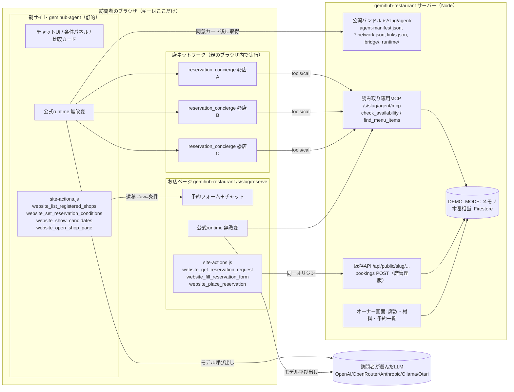
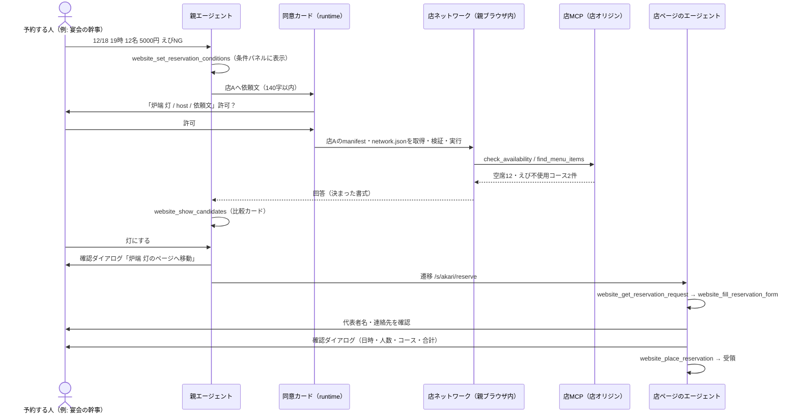

# 飲食店予約エージェント（通常予約と宴会・パーティー予約） 仕様書（Open Agentic Web Challenge 応募作）

- 版: v0.2（2026-11-14 JST。v0.1 は宴会のみ → v0.2 で通常予約・席のみ予約に対応）
- 対象リポジトリ: 
  - お店サイト: gemihub をプライベートに複製したもの（名前未定。本書では仮に `takeshy/gemihub-restaurant`）
  - 親サイト: `takeshy/gemihub-agent`（プライベート、空）
- 準拠する規格: Worldwide Agentic Web **MVP Profile 0.2**（2026-11-06）
  - 規格本文: https://github.com/cognizant-ai-labs/agentic-web/blob/main/docs/worldwide_agentic_web_mvp_spec.md
  - 実装手順（公式スキル）: https://github.com/cognizant-ai-labs/agentic-web/tree/main/skills/agentify-website
  - 本書が参照した規格リポジトリのコミット: `512d948`（2026-11-13 13:59 JST）。規格リポジトリは「頻繁に変わる」と明記されているので、着手時と提出前に差分を確認すること。
- 参照した gemihub: `takeshy/gemihub` main（最新 `53568e6`、2026-11-12 22:22 JST）

> 表記ルール: 規格の要件は **MUST / MUST NOT / SHOULD / MAY** を原文のまま残す。規格や公式コードに書かれていないことを本書が決めた場合は「（本書の設計）」と書く。分からないことは **【要確認】** と書く。

---

## 0. 守ること（作業前に必ず読む）

| 制約 | 内容 |
|---|---|
| 触らないもの | gemihub.net 本番、テスト用アカウント、`takeshy/gemihub` の main ブランチ、コミット `08c75b6`（**2026-12-15 まで**）。kakeratta。 |
| 複製の方法 | `takeshy/gemihub` は**読むだけ**。push・ブランチ作成・PR は一切しない。中身を `gemihub-restaurant` に取り込み、以降はそちらだけで作業する。 |
| 公式ランタイム | `skills/agentify-website/runtime/` を**改変せず**コピーする（スキル自身も「Do not edit or replace」と明記）。 |
| スコープ外 | PayPal、電話AI受付（Twilio）、お店負担のLLM経路（gemihub の Vertex AI/Gemini によるお客様向け応答）、ステージング環境、カレンダー連携。 |
| 実行環境 | 開発はローカル。提出には公開 URL が必要なので、公開方法は §6.4 で「要検討」の選択肢だけ示す。 |
| 秘密情報 | API キー、トークン、個人情報を公開ファイル（manifest、network.json、URL）に入れない。 |

---

## 1. 目的とデモシナリオ

### 1.1 目的
飲食店の予約を、**通常の予約**（例: 今夜19時に2人、席だけ）から**宴会・パーティー予約**（例: 12/18 金曜19時から12人、1人5,000円以内のコース、えびが食べられない人がいる）まで、同じ仕組みで扱う。

- 予約したい人は、**自分の LLM キー（BYOK）**で動く親サイトのエージェントに条件（日時・人数・任意で予算・避けたい食材・コースの要否）を話すだけ。親は登録店のエージェントに空席とメニュー（コース・料理）の内容を問い合わせ、予約できる店を比べて見せる。
- 選んだ店のページに条件ごと移動すると、**そのお店のエージェント**が残りを聞いて予約を仕上げる（確定は確認ダイアログ）。コースを選ばない**席だけの予約**もできる。
- お店側は gemihub ベースで、メニュー（コース・料理）ごとの**材料**と、**予約用に確保した席数**だけを登録すればよい。席数は状況を見て増減できる。LLM 代はお店も親サイトも払わない。

予約の種類（本書の設計。データ上は 1 種類の「予約」で、違いは人数・コースの有無・利用時間の既定値だけ）:

| 種類 | 例 | コース | 利用時間の既定値 |
|---|---|---|---|
| 通常予約 | 今夜19時に2人、席だけ | 任意（なしで可） | 店の設定 `standardMinutes`（例 90 分） |
| 宴会・パーティー予約 | 12/18 19時から12人、コース | 任意（多くはコースあり） | 店の設定 `largePartyMinutes`（例 120 分）。人数が `largePartyFrom`（例 7 名）以上、またはコースに利用時間があればそれ |

### 1.2 デモシナリオ（2分未満の動画）
見せ場は宴会。途中で通常予約も同じ仕組みで扱えることを短く見せる。

| 秒 | 画面 | 見せること（本人ナレーション） |
|---|---|---|
| 0–10 | 親サイト トップ | 課題：飲食店探しは、空席・コース・アレルギー対応を電話で聞いて回る作業。宴会だと特に大変。 |
| 10–18 | 親サイト ⚙ AI model settings | 訪問者が自分のキー（例: OpenRouter）を入れる。お店は LLM 代を払わない。 |
| 18–38 | 親サイト チャット | 宴会の条件を話す → 条件パネルが埋まる（`website_set_reservation_conditions`）。 |
| 38–62 | 同意カード×3 → 結果 | 3店それぞれの**同意カード**（店名・ホスト・問い合わせ文）で「許可」。各店のネットワークがブラウザ内で動き、空席とコースの材料を答える。比較カードが出る（1店は満席）。 |
| 62–72 | 通常予約（短く） | 「ちなみに今夜19時に2人、席だけなら？」→ 同じ流れで「席のみ・空きあり」の比較カード。コース不要でも同じ仕組み、と一言。 |
| 72–82 | 店選択 | 宴会に戻り「炉端 灯（あかり）にする」→ 移動の確認ダイアログ（`website_open_shop_page`）。 |
| 82–106 | お店ページ | 条件が引き継がれ、お店のエージェントが「えび不使用の『冬の炉端コース』で12席空いています。代表者名と連絡先を」→ 確認ダイアログで予約確定。 |
| 106–118 | オーナー画面 | 席の残数が減っている。席数を 20→24 に増やすとすぐ反映。 |

> 注: 規格どおり、親は店の予約を**呼べない**（§2.4）。動画でも「確定はお店のページで、お店のエージェントが行う」ことをはっきり見せる。これはこの作品の設計上の主張でもある。
> 撮影の都合で 2 分を超えそうなら、62–72 秒の通常予約は画面の切り替えだけにして、説明文で補う。

---

## 2. 規格要件と適合チェックリスト

### 2.1 ハッカソン要項（DevPost）
出典: https://cognizant-agenticweb.devpost.com/

- 締切: **2027-01-11 8:00 PST = 2027-01-12 01:00 JST**（DevPost 本文では「January 11, 2027 at 16:00 UTC」）。
- 作るもの: 規格に適合した、標準 Web 技術で動く open agentic website。
- 提出物:
  - 公開 URL。次を含むこと: 公開された適合 `.json`（エージェントネットワークと能力の記述）、ブラウザで動かす `runtime`、利用者（または他エージェント）が対話する UI、LLM とキーを設定する UI（任意）。ネットワークはサイトと連携し、任意で他の agentic website と連携／他から呼ばれること。
  - 説明文（機能の説明）。
  - **2分未満**の動画。ブラウザで動いている様子を含み、**本人が説明（AI 生成音声は不可）**、YouTube で公開。第三者の商標・著作物（音楽等）は許可なく使わない。
  - スクリーンショット 1 枚以上。
  - Otari を使った場合は Otari アカウントのメールと、困った点の 1〜2 文。
  - 任意: 作ったツールをコミュニティに共有すると Potential Impact で考慮されうる。
- 審査（均等とは DevPost 上に明記なし【要確認：森田さんの情報では均等評価】）: Technological Implementation / Design / Potential Impact / Quality of the Idea。
- 第1段階の適合チェックの具体的な方法は公開されていない【要確認】。README の Testing 節は「TODO: Run the validation script」のまま。コミュニティ製のチェッカー（例: AgentCheck、34 ルール）があるが非公式。

### 2.2 規格の骨子（MVP Profile 0.2）
- サイトは**データだけ**のネットワーク定義（Neuro SAN HOCON、ブラウザ向けに解決済み JSON）と `agent-manifest.json`、`links.json` を公開する（§2, §3.3）。
- ブラウザの JS ランタイムがネットワークを実行する（§3）。
- 推論は差し替え可能。サイトの既定ルーター、または訪問者の BYOK（§4）。
- 他サイトのネットワークは、URL で指定し、**訪問者の同意後**に取得して**呼び出し側のブラウザで**実行する（§3.2）。
- 他サイトの「サイト操作」（site action）を呼ぶクロスサイト実行は**拡張扱いで MVP の範囲外**（§1.2, §3.2 MVP boundary）。

### 2.3 適合チェックリスト

凡例: 【M】= MUST/MUST NOT、【S】= SHOULD、【任】= MAY/任意、【実】= 公式スキル・ランタイムの実装上の要件（規格本文ではないが外すと動かない）。

#### A. 公開ファイル（§3.3, §3.4）
| # | 要件 | 区分 | 店 | 親 |
|---|---|---|---|---|
| A1 | `agent-manifest.json` を公開 GET。`networks[]` に `name`・`front_man`・`hocon`、トップサイトの LLM ルーター情報、peer policy を含む | M（表の Required content） | ✓ | ✓ |
| A2 | ネットワーク定義（Neuro SAN スキーマに沿った解決済み JSON）を manifest の `hocon` の場所で公開 GET | M | ✓ | ✓ |
| A3 | 別オリジンから取得されるファイルは標準の CORS で許可する（`Access-Control-Allow-Origin: *` を manifest / network.json / links.json / agent-mcp.json / .well-known 2 種に付ける） | M（§3.3「the publisher MUST permit browser access」）＋実 | ✓ | ✓ |
| A4 | `links.json`（発行者所有の既定ピア対応表）を公開 GET | 表で Required | ✓ | ✓ |
| A5 | 本番は **HTTPS**（ループバックの HTTP はローカル開発のみ可） | M | ✓ | ✓ |
| A6 | 公開アーティファクトの取得に呼び出し側の秘密情報（Cookie 等）を含めない | M（§3.4） | ✓ | ✓ |
| A7 | `.network.json` というファイル名は慣習。ランタイムは manifest の場所を使う | 任 | | |
| A8 | `.well-known/nsdeploy/` 等の発見用メタデータ | 任（ビルドが自動生成） | ✓ | ✓ |
| A9 | 呼び出し元が隠し iframe で読む `bridge/action-bridge.html` を公開し、`X-Frame-Options` / `frame-ancestors` で枠表示を禁止しない | 実（linking.md） | ✓ | ✓ |

#### B. ネットワーク定義（§2）
| # | 要件 | 区分 |
|---|---|---|
| B1 | Neuro SAN Agent Network HOCON の形式に従う。公開形はデータモデルを保ち、ローカル include・環境変数置換・発行者専用パスに依存しない | M |
| B2 | 宣言的データであること。指示文とスキーマは公開物で、機密保持の手段として扱ってはならない | M / M NOT |
| B3 | ネットワーク名・短い説明・front agent 名。各エージェントに一意の名前・function 説明・（LLM を使うなら）instructions・呼べる tools のリスト | 2.1 Minimum content |
| B4 | 呼べるエージェント／ツールは JSON Schema 互換の入力。構造化出力もスキーマを宣言する | 入力は必須扱い、出力は S |
| B5 | private context（sly_data）は既定で境界を越えない。流すフィールドは明示的に名前を挙げる | M |
| B6 | 使えない外部能力は fail closed で明確に報告し、ブラウザのセキュリティを迂回しない | M |
| B7 | `demo_mode` や「それらしい結果を作れ」という指示を入れない。AAOSA を使わない | 実（build_network.mjs がエラーにする） |
| B8 | 指示文に `{peer_rules}`（他サイトから呼ばれたとき用）、パートナーを呼ぶ場合は `{partner_rules}` を残す | 実 |

#### C. ランタイムの振る舞い（§3.1, §4, §5）— 公式ランタイムを無改変で使うことで満たす
| # | 要件 | 区分 |
|---|---|---|
| C1 | 通常の Web ページから使え、JS でグラフを実行する | M |
| C2 | 不正なネットワーク・参照切れ・不正 front agent を**モデル呼び出し前に**拒否 | 3.1 |
| C3 | ローカルのサイト操作: 引数を検証し、**書き込みや取り消せない操作の前に宛先と引数を利用者に示す** | M（※下記ギャップ） |
| C4 | 書き込み開始後のタイムアウト・切断は「結果不明」と報告し、ランタイムが勝手に再実行しない | M / M NOT |
| C5 | 合成の深さ・呼び出し回数・リモート呼び出し・並行数・経過時間に上限 | M（公式: 1メッセージあたりパートナー4回・同一パートナー1回・エージェント24回・90秒・ネスト5段） |
| C6 | 第三者オリジンへの接触前に、オリジンと目的を示して同意を得る。緩和は利用者の明示的選択のみ | M |
| C7 | 要求したネットワーク名が manifest に完全一致しなければ失敗（別のネットワークで代用しない） | M |
| C8 | ピアの結果経路で private context を返さない（明示許可分を除く） | M |
| C9 | BYOK 時、キーは選んだルーターへのモデル要求にだけ付ける。URL・manifest・ネットワーク定義・プロンプト・操作引数・トレース・分析・ピアへの要求に入れない | M NOT |
| C10 | ピアは呼び出し側のルーターを継承し、置き換えたりキーを受け取ったりできない | M |
| C11 | BYOK を提供するなら、ルーター URL・モデル・資格情報を選択／入力できる。保存したプロファイルを削除できる | M |
| C12 | キー必須のルーターでキーが無ければ、モデル呼び出しを止めて明確なエラー | M |
| C13 | ピアのネットワーク定義は信頼できない入力として扱う | M |
| C14 | 第三者スクリプトを減らし、制限的な CSP を使う | S |
| C15 | 選択中のルーター・接触したオリジン・エージェント／ツール呼び出し・同意・エラー・操作の受領を、秘密を出さずに見せる | S |
| C16 | 確認はモデルではなくランタイムが持つ。実行される操作・オリジン・引数・リクエスト ID・受領は確認した提案に結び付く | 5 User-owned writes |

**既知のギャップ（公式スキルに明記）**: 公式ランタイムでは `effect: "write"` の操作は**ダイアログなしで即実行**される。規格 §3.1 は書き込み前の提示を求めているので、本作では「訪問者がページ上で見て元に戻せる表示の変更（フォーム入力・条件パネル）」だけを `write` にし、**予約確定・ページ遷移は `irreversible`（確認ダイアログ）**にする（本書の設計）。説明文でもこのギャップを正直に書く。

#### D. 推論（§4）
| # | 要件 | 区分 |
|---|---|---|
| D1 | 既定ルーター＋モデルを公開してもよい（発行者負担可） | 任 |
| D2 | BYOK は任意。ただし §6 の相互運用チェックは「サイトの既定ルーターで動かす。BYOK があればその経路も」と書く | — |
| D3 | 本作は**BYOK のみ**（お店負担の経路はスコープ外）。公式の例（ピザ・ゲストハウス）も `llm_router.base_url` に Otari を置き、訪問者のキーで動かしている。**BYOK だけで §6 の「既定ルーター」チェックを満たすと見なされるか【要確認】** | — |
| D4 | 対応先: OpenAI / OpenRouter / Anthropic（ブラウザ呼び出しを組織が許可している場合）/ Ollama（ローカルのみ）/ Otari。ブラウザから直接呼ぶのでルーター側の CORS が必要（docs/providers/providers.md） | 実 |

#### E. 相互運用チェック（§6）— デモとテストで示す
| # | 示すこと | 本作での示し方 |
|---|---|---|
| E1 | 2 エージェント以上の HOCON ネットワークと manifest を普通の HTTPS ホストで公開 | 店・親とも front agent ＋ 1 専門エージェント以上（§4.6, §5.5） |
| E2 | ブラウザで実行（既定ルーター／BYOK） | 両サイト |
| E3 | 内部エージェント呼び出しと、MCP または登録済みローカル操作による根拠付き能力を 1 つ以上 | 店: `website_*` と店の MCP。親: `website_*` |
| E4 | 利用者の承認後、別オリジンの**名前で指定したネットワーク**を読み込み、呼び出し側ブラウザで実行 | 親 → 3 店（本作の中心） |
| E5 | ユーザーキー使用時、2 つ目のサイトがキーを受け取らず、ルーターを変えられない | 店サーバーのアクセスログ（Authorization ヘッダー無し）で示す |
| E6 | 名前を明示して許可しない限り、private context がピアに無い | 親の sly_data に試験用フィールドを置き、店側に届かないことをテスト |
| E7 | 不正ネットワーク・合成の循環・予算超過・拒否されたオリジンが、見えるエラーで止まる | 親のテストで 4 種を再現 |

### 2.4 規格上の重要な発見（設計に効くもの）

1. **親は店の操作を呼べない。** ピアのネットワークは呼び出し側のブラウザで動き、`website_*` ツールは**訪問者が今いるサイトにしか**付かない（linking.md「Site tools」、`runtime/runner.js` `buildToolTable`）。公式文書は「パートナーはライブの空き状況・価格・予約を出せない。ページを案内するだけ」とまで書いている。
2. **ただし MCP は規格の基本線。** §3.1「Support MCP as the baseline interface for tools and data」、§2.1「An agent MAY reference … an MCP server」。ピアのネットワークが**自分のオリジンにある MCP**を呼ぶのは許されており、公式文書も「the partner's network can pass it to an MCP server on the partner's own origin without another card」と書いている。
   - 実装確認: ピアのネットワークは自分のサイトベースを `baseOrigin` として動き（`engine.js` `_makeCtx`）、MCP の同意要否は `target.origin !== baseOrigin` で決まる（`runner.js` `requiresThirdPartyApproval`）。つまり**店の MCP が店と同じオリジンなら、親での同意カードは店ネットワーク読み込み時の 1 枚だけ**。
   - MCP の宛先は「呼んだネットワークの manifest の `allowed_peers`」で検査される（`engine.js` `resolveMcp` → `_assertAllowedPeer`）。`peer_policy.mode: "closed"` のままなら、**店の manifest の `allowed_peers` に店自身のオリジンを入れる必要がある**。
   - MCP 呼び出しは「パートナー呼び出し 4 回」の予算には数えられない（`consumeRemoteBudget` はリモートネットワーク呼び出しだけ）。
3. **ピアに渡るのは依頼文だけ。** チャット履歴も sly_data も渡らない（`runner.js` `dispatchToolCall`）。同意カードは依頼文の先頭 140 文字しか見せないので、依頼文は 140 文字以内・個人情報なし（名前・メール・電話・予約番号を入れない）。
4. **同意は第三者オリジンごと。** 「Always allow」はそのホストに対してページ再読み込みまで有効（`engine.js` `requestConsent`）。**3 店が同じホスト（例 `/s/<slug>/` 配下）だと、1 店で Always allow すると残りもカードなしになる。**デモで 3 枚見せたいなら「許可（今回のみ）」を押すか、店ごとに別ホストにする（本書の設計: ローカルは同一ホストでよい。動画は「許可」を 3 回押す）。
5. **BYOK のキーはオリジンごとの localStorage。** 親から店ページへ移動すると、**店ページで再度キー入力が必要**（ローカルの localhost/127.0.0.1 ではキーを Cookie に写すことがあるので、ローカルでは気づきにくい）。URL でキーを渡すのは C9 違反。→ UX 上の注意点として §5.4 で扱う。
6. **条件の受け渡し方法は規格に定めが無い。** 規格はクロスサイト操作を MVP 外とし、ページ遷移でのデータ受け渡しは規定していない。普通のリンク遷移は規格の対象外なので、本作は**URL のフラグメント**で条件を渡す（本書の設計、§5.4）。規格上の禁止事項（キーを URL に入れない、個人情報を他サイトへの依頼に入れない）に抵触しない形にする。
7. **gemihub の現在のセキュリティヘッダーはそのままでは動かない。** `server/app.ts`（1195 行付近）が全レスポンスに `X-Frame-Options: DENY`、`frame-ancestors 'none'`、`connect-src 'self'` を付けている。`bridge/` の枠表示、ブラウザから LLM ルーターへの直接通信、親からの CORS 取得のために、**エージェント関連パスだけ**ヘッダーを変える必要がある（§4.7）。

### 2.5 親→店の「問い合わせ」方式の結論

**採用: 方式A「店のネットワークをピアとして読み込み、店エージェントが店オリジンの読み取り専用 MCP で答える」**

```
親のfront agent ──(同意カード)──▶ 店のネットワーク(親のブラウザ内で実行・訪問者のキー)
                                        └─▶ 店の MCP（店オリジン, 読み取り専用, CORS許可） ─▶ 空席・材料
```

根拠:
- ピア読み込みは §3.2 の最小プロトコルそのもので、§6 の E4 を満たす。
- 店エージェントの根拠付き能力に MCP を使うのは §3.1・§2.1 の基本線。読み取り専用なので「クロスサイトのサイト操作」（MVP 外）に当たらない。
- 同じオリジンの MCP は同意カードが増えない（§2.4-2）。
- 予約確定は MCP に**出さない**。確定は店ページの `website_place_reservation`（irreversible、確認ダイアログ）だけ。

不採用・予備:
- 方式B（親が店の MCP を直接 `tools` に並べる）: 規格上は可能。ただし MCP の発見と呼び出しのたびに同意カードが出て（`runner.js` 144–160, 391–408 行）、店のエージェントが答える形にならない。店が 5 店以上になり「パートナー4回」制限に当たる場合の予備にする。
- 方式C（クロスサイト操作の拡張: iframe/ポップアップのブリッジ）: §7 の拡張で MVP 外、公式ブリッジも「No actions exposed to this caller」。使わない。

**【要確認】** 規格 §5「Per hop policy: Every additional peer or MCP hop repeats the origin-policy and consent checks」の読み方。公式ランタイムは「ピアと同じオリジンの MCP は新しい境界ではない」と扱い、カードを出さない（オリジン方針チェックは行う）。適合審査でこれが問題視されないか、Discussions で確認すると安全。

---

## 3. 全体アーキテクチャ



シーケンス（問い合わせ〜予約）:



---

## 4. お店サイト仕様（gemihub-restaurant）

### 4.1 gemihub の現状（調査結果）
| 項目 | 内容 | ファイル |
|---|---|---|
| 構成 | Node 24 以上、TypeScript。フレームワーク無しの `http.createServer`。フロントは React + Vite | `server/index.ts`, `server/app.ts`（約 318KB）, `src/main.tsx`, `src/App.tsx` |
| 起動 | `npm ci` → `cp .env.example .env` → `npm run build` → `npm start` → http://localhost:3000 の「サロンのデモを試す」。開発は `npm run dev`。テスト `npm test`（`tsx --test tests/*.test.ts`） | `README_ja.md`, `package.json`, `docs/development_ja.md` |
| デモモード | `.env` の `DEMO_MODE=true` でインメモリ（再起動で消える）。Google/Vertex 無しでフォーム編集とサロンデモが動く。お客様ログイン不要の「デモのお客様」で予約できる（`demoShoppersEnabled`） | `.env.example`, `server/app.ts` 3639 行付近 |
| データモデル | `shopSchema`（zod）: `industry: "nail"｜"hair"｜"other"`、`menus[]`（id, name, duration, price, active, optionFor…）、`staff[]`、`hours`、`rules`（interval, advanceDays, leadMinutes, sameDay, cancelHours, payment）。`Booking`（customer, name, menuId, staffId, start, end, status, payment…） | `server/domain.ts` |
| 店の保存 | `Shop`（id, slug, published, draft, revision, history…）。`store.locked(bookingLockKey(shopId))` で予約を排他 | `server/store.ts` |
| 空き枠計算 | `slots(config, bookings, date, menuId, staff…)`：営業時間とスタッフの勤務・既存予約から**スタッフ単位**で計算 | `server/domain.ts` 281 行〜 |
| 公開ページ | 店のトップ等は生成済み HTML（`/s/<slug>`、独自ドメインは `/`）。予約・マイページはアプリ（`PublicShop`） | `server/storefront-build.tsx`, `src/App.tsx` 1376 行 `PublicShop` |
| 公開 API | `/api/public/<slug>/<action>`：`slots`, `slots/next`, `bookings`（GET/POST）, `checkouts`, `waitlist`… | `server/app.ts` 3639 行〜, 4001 行〜 |
| AI | 店主向けの相談・設定提案・デザイン生成（Vertex AI Gemini、**お店／運営者負担**）。今回のお客様向けエージェントには**使わない** | `server/ai.ts`, `server/assistant.ts`, `server/settings-ai.ts`, `src/Assistant.tsx` |
| セキュリティヘッダー | 全レスポンスに `X-Frame-Options: DENY` と `default-src 'self'; script-src 'self'; connect-src 'self'; frame-ancestors 'none' …` | `server/app.ts` 1195–1203 行付近 |

### 4.2 複製の手順（cloud agent 向け）
1. `takeshy/gemihub` を**読み取りだけ**で取得し、`gemihub-restaurant`（プライベート）の初回コミットにする。基準コミットは**【要確認】**（`08c75b6` 以降、main は `53568e6` まで進んでいる。どちらを基準にするか森田さんに確認）。
2. 元リポジトリに remote を張らない／push しない。
3. 除外: PayPal・電話・カレンダーのコードは**消さずに無効化**（環境変数で OFF、UI から隠す）。差分を小さく保つため。

### 4.3 データモデルの拡張（本書の設計）

`server/domain.ts` の `shopSchema` に追加:

```ts
industry: z.enum(["nail", "hair", "restaurant", "other"]),

// メニュー（menus[]）に追加。industry === "restaurant" のとき ingredients は必須（コース・料理の両方）
kind: z.enum(["course", "dish", "drink"]).optional(),   // course だけが予約時に選べる。dish/drink は問い合わせ用の情報
ingredients: z.array(z.string().trim().min(1).max(40)).min(1).max(60).optional(),
allergens: z.array(z.enum([
  "egg","milk","wheat","buckwheat","peanut","shrimp","crab","walnut", // 特定原材料（表示義務）8品目
  "other"
])).max(9).optional(),
allergenNote: z.string().max(300).optional(),            // 「同じ厨房でえびを扱います」等
minPeople: z.number().int().min(1).max(200).optional(),  // course のとき
maxPeople: z.number().int().min(1).max(200).optional(),  // course のとき
courseMinutes: z.number().int().min(30).max(360).optional(), // course の利用時間（あれば最優先）
// price: course は「1人あたり」、dish/drink は 1 品の価格

// 席の設定（新規。通常予約と宴会で共通）
seating: z.object({
  reservableSeats: z.number().int().min(0).max(500),           // お店が予約用に確保する席数（基本値）
  standardMinutes: z.number().int().min(30).max(360).default(90),   // 通常予約の利用時間
  largePartyMinutes: z.number().int().min(30).max(360).default(120),// 宴会の利用時間
  largePartyFrom: z.number().int().min(2).max(200).default(7),      // この人数以上を宴会として扱う
  startTimes: z.array(clock).min(1).max(48),                    // 受付開始時刻 例 ["17:00","17:30",...]
  minPartySize: z.number().int().min(1).default(1),
  maxPartySize: z.number().int().min(1).max(200),
  seatOnly: z.boolean().default(true),                          // 席だけの予約（コースなし）を受けるか
  overrides: z.array(z.object({                                 // 日付ごとの増減
    date: z.iso.date(),
    reservableSeats: z.number().int().min(0).max(500),
    note: z.string().max(100).optional(),
  })).max(400).default([]),
}).optional(),
```

`superRefine` に追加:
- `industry === "restaurant"` なら `seating` 必須。`active` な**すべてのメニュー（course・dish・drink）**の `ingredients` 必須（**材料必須**の要件）。
- `minPartySize <= maxPartySize`、`minPeople <= maxPeople`、`overrides` の日付重複禁止。
- `seatOnly === false` なら、予約できる `course` が 1 つ以上必要。

`Booking` に追加:

```ts
partySize?: number;         // 人数（=使う席数）
courseId?: string;          // 任意。なし＝席のみ予約
durationMinutes?: number;   // 予約時に確定した利用時間（後で店が設定を変えても既存予約は変わらない）
dietaryNote?: string;       // 「1名えびNG」など自由記述（max 300）
```

- 既存の `menuId` は必須の文字列なので、互換のため**席のみ予約では予約用の固定値 `"seat"`**、コースありでは `courseId` と同じ値を入れる（本書の設計。`menus[]` に id `seat` は作らない。一覧・書き出しでは `courseId` が無ければ「席のみ」と表示）。
- `staffId` は `"owner"`（`ownerStaffId`）固定で保存し、既存の一覧・書き出しを壊さない。
- 予約時に `price` は「コース単価×人数」、席のみは `0`。

### 4.4 席の空き計算（本書の設計）
新規 `server/seats.ts`（通常予約と宴会で共通）:

```ts
export function seatsFor(config, date): number           // overrides があればそれ、無ければ reservableSeats
export function durationFor(config, partySize, courseId?): number
  // courseMinutes があればそれ → partySize >= largePartyFrom なら largePartyMinutes → それ以外 standardMinutes
export function seatAvailability(config, bookings, date, partySize, courseId?, now): Array<{
  start: string; end: string; reservable: number; booked: number; remaining: number; fits: boolean;
}>
export function canSeat(config, bookings, date, start, partySize, courseId?, now): { ok: true; durationMinutes: number } | { ok: false; reason: string }
```

- 各開始時刻 `t` について、利用時間 `d = durationFor(...)` の区間 `[t, t+d)` と重なる `status === "active"` の予約（各予約は自分の `durationMinutes` で区間を持つ）の `partySize` 合計の**最大値**を `booked`、`seatsFor(date) - booked` を `remaining`、`remaining >= partySize` を `fits`。
- 既存の `closedOn`, `hoursForDate`, `rules.advanceDays`, `rules.leadMinutes`, `rules.sameDay` はそのまま使う（`domain.ts`）。終了が閉店を超える枠は出さない。
- コース指定時は `minPeople`〜`maxPeople` を確認。席のみ予約は `seatOnly` が true のときだけ受ける。
- 席数を減らして既存予約を下回った場合: 既存予約は消さない。`remaining` は 0 で止め、オーナー画面に「超過 n 席」と出す。
- 予約作成は既存どおり `store.locked(bookingLockKey(shop.id))` の中で `canSeat` を再確認する（二重予約防止）。
- 卓（テーブル）単位の割り当ては**しない**（席数の合計だけで管理）。2 人で 4 人席を使う等の実態とのずれは、お店が確保席数で調整する前提（本書の設計。作り込みすぎない）。

### 4.5 オーナー向け機能
| 機能 | 内容 | 主な変更ファイル |
|---|---|---|
| 業種「飲食店」 | 初回設定で選べる。選ぶとスタッフ欄を隠し、席の設定を出す | `src/App.tsx`（`ConfigEditor`）, `shared/en.json`（文言） |
| 席の設定 | 予約用の席数、利用時間（通常予約・宴会それぞれ）、宴会扱いにする人数、受付開始時刻、人数の下限・上限、席のみ予約を受けるか | `src/App.tsx`（`ConfigEditor`、新コンポーネント `SeatSettings.tsx`） |
| 日ごとの増減 | カレンダー形式の一覧で日付ごとに席数を上書き。「今日だけ+4」ボタン | 新 `src/SeatOverrides.tsx` |
| メニューの材料 | メニュー編集に種別（コース／料理／飲み物）、材料（タグ入力・**全種別で必須**）、アレルゲン（8品目チェック）、注記。コースは人数の範囲と利用時間（任意） | `src/App.tsx`（`ConfigEditor` のメニュー欄） |
| 予約一覧 | 日付ごとの時間帯×（確保席・予約済み・残り）表と予約の明細（人数・コースまたは「席のみ」・利用時間・食事の注記）。通常予約と宴会を同じ表で、宴会（`largePartyFrom` 以上）に印 | `src/App.tsx`（`Reservations`）, 新 `src/SeatBoard.tsx` |
| 書き出し | `partySize`, `courseId`（空＝席のみ）, `durationMinutes`, `dietaryNote` を CSV 列に追加 | `server/data-export.ts` |
| AI で設定（任意） | 既存の「AIで設定」は Vertex（運営負担）なので**今回は使わない**。フォームだけで完結させる | — |

### 4.6 お店のエージェントネットワーク

ネットワーク名: `reservation_concierge`（全店共通名。URL で区別する）。公開場所: `https://<host>/s/<slug>/agent/`。
ネットワーク URL: `https://<host>/s/<slug>/agent/reservation_concierge`（§3.2 Reference：最後の要素がネットワーク名、その前がサイトベース）。

| エージェント | 役割 | tools |
|---|---|---|
| `reservation_front`（front_man） | 予約の問い合わせ窓口（通常予約・席のみ・宴会）。店ページでは予約まで、他サイトから呼ばれたときは空席とメニューの材料だけ答える | `menu_allergen_checker`, MCP `{"url": "https://<host>/s/<slug>/agent/mcp", "tools": ["check_availability","find_menu_items"]}`、（店ページでのみ）`website_*` |
| `menu_allergen_checker` | コース・料理の材料とアレルゲンを照合し、避けたい食材を含むか・記載なしか・不明かを短く返す | 同 MCP の `find_menu_items` |

指示文の要点（`templates/network.hocon` をもとに作る）:
- 1 文目: 「〈店名〉の予約を手伝う。少人数の席予約から宴会・パーティーまで、空席、コースや料理の内容と材料、予約を扱う。」（他サイトはほぼこの文しか知らない）
- コースの要否を勝手に決めない。条件に無ければ「席のみ」と「コースあり」の両方を短く示す。
- `{grounding_rules}`: 事実は MCP と `website_*` の結果からだけ。材料に無い食材を「入っていない」と断言しない。「材料表に記載がない／不明」と言う。**アレルギーの最終確認はお店に**と一言添える（作り込みすぎない）。
- 他サイトから呼ばれた場合の回答書式（本書の設計。親が比較しやすいように）:

```
店名: ...
空席: 2026-12-18 19:00 残り14席（12名OK、利用120分）
席のみ: 可
コース: 冬の炉端コース 5,000円/人（2〜30名） 避けたい食材: えび→含まない（材料表）
注意: 同じ厨房でえびを扱う
予約: このお店のページで予約できます
```

通常予約（席のみ）の例:
```
店名: ...
空席: 2026-11-14 19:00 残り6席（2名OK、利用90分）
席のみ: 可
料理: 避けたい食材 えび→含む料理2品（えびの串焼き、海鮮サラダ）、他は記載なし
予約: このお店のページで予約できます
```

- `{peer_rules}` は残す（呼び出し側では `website_*` が無い）。
- `{partner_rules}` は不要（店は他を呼ばない）。
- `sample_queries`（4〜6）: 「今夜19時に2人、席だけ空いていますか」「12月18日19時から12名、空いていますか」「えびを使わないコースや料理は」「1人5,000円以内のコースは」「この条件で予約して」（店ページ）、断る例「PayPalで前払いしたい」。

### 4.7 公開バンドルとサーバー側の追加（本書の設計）

ディレクトリ（`gemihub-restaurant` 内）:

```
agentic/
  runtime/                      ← skills/agentify-website/runtime を無改変コピー（コピー元コミットを README に記録）
  reservation_concierge.hocon         ← 雛形。店ごとの値（店名・MCP URL・allowed_peers）は生成時に埋める
  site-actions.js               ← website_* 登録（店ページ用）
  site.js / assistant.css / assistant-section.html
  tests/                        ← templates/tests をもとに
scripts/
  build-shop-agent.mjs          ← 店ごとに hocon と manifest を生成し、公式 build_network.mjs を呼ぶ
server/
  agentic.ts                    ← /s/<slug>/agent/* の配信・ヘッダー・MCP
  seats.ts
```

- **ネットワーク定義は店ごとに生成**する（MCP の URL と `allowed_peers` に店のオリジンが入るため）。生成は公式 `scripts/build_network.mjs <hocon> --manifest <manifest>` を通す（パーサー・検証・`bridge/`・`.well-known`・`agent-mcp.json` を自動生成）。店の設定保存時・公開時に再生成し、メモリ（DEMO_MODE）または既存のストレージに置く。**生成物を手で編集しない**（スキルの規則）。
- `server/agentic.ts` のルート:

| パス | 内容 | ヘッダー |
|---|---|---|
| `GET /s/<slug>/agent/agent-manifest.json` | 店の manifest | `Access-Control-Allow-Origin: *`、Cookie を読まない |
| `GET /s/<slug>/agent/reservation_concierge.network.json` | 解決済みネットワーク | 同上 |
| `GET /s/<slug>/agent/links.json`, `agent-mcp.json`, `.well-known/nsdeploy.json`, `.well-known/nsdeploy-agent.json` | ビルド生成物 | 同上 |
| `GET /s/<slug>/agent/bridge/*` | 呼び出し元が隠し iframe で読む | **`X-Frame-Options` を付けない、`frame-ancestors` を付けない** |
| `GET /s/<slug>/agent/runtime/*` | ランタイム | `runtime/sandbox-worker.js` に `Content-Security-Policy: default-src 'none'; script-src blob:; connect-src 'none'; worker-src 'none'` |
| `POST/OPTIONS /s/<slug>/agent/mcp` | 読み取り専用 MCP（JSON-RPC 2.0 / プロトコル 2025-06-18。`initialize`・`notifications/initialized`・`tools/list`・`tools/call`） | `Access-Control-Allow-Origin: *`、`Access-Control-Allow-Methods: POST, OPTIONS`、`Access-Control-Allow-Headers: Content-Type, Accept, MCP-Protocol-Version, Mcp-Session-Id`、`Access-Control-Expose-Headers: Mcp-Session-Id`。認証なし・Cookie 無視・レート制限（例 60 回/分/IP） |
| `GET /s/<slug>/reserve` | お店の予約ページ（通常予約・席のみ・宴会を 1 画面で）（React の `PublicShop` 拡張＋アシスタント） | CSP を緩める: `connect-src 'self' https: http://localhost:* http://127.0.0.1:*`（BYOK ルーターへの直接通信）。`frame-src` は既存＋必要なら呼び出し先。その他は既存どおり |

- 業務エンドポイント（`/api/public/...`）には CORS を**付けない**（スキル: "Do not add that header to business endpoints"）。
- MCP ツール（読み取りのみ。個人情報を返さない）:

| ツール | 入力（JSON Schema） | 出力 |
|---|---|---|
| `check_availability` | `{date: string(YYYY-MM-DD), time?: string(HH:MM), partySize: integer 1–200, courseId?: string}` | `{shop, date, weekday, durationMinutes, reservationType:"standard"\|"large_party", seatOnlyAllowed:boolean, slots:[{start:"19:00", remaining:14, fits:true}], closed:boolean, reason?:string}` |
| `find_menu_items` | `{kind?: "course"\|"dish"\|"drink"\|"any"（既定 any）, partySize?: integer, budgetPerPerson?: integer, avoid?: string[]（例 ["shrimp","えび"]）}` | `{currency:"JPY", items:[{id,kind,name,price,priceText:"5,000円/人",minPeople?,maxPeople?,ingredients[],allergens[],allergenNote,matchesAvoid:"contains"\|"not_listed"\|"unknown"}]}`（`kind:"course"` だけが予約時に選べる） |

  `avoid` の照合は材料とアレルゲンの文字列一致＋8品目の日英対応表（えび=shrimp 等）だけ。曖昧なら `unknown`（本書の設計。作り込みすぎない）。

### 4.8 お店ページの `website_*` ツール

`agent-manifest.json` の `actions.agentTools` に列挙し、`site-actions.js` で `actions.register()` する。

| 名前（モデルが見る名前） | effect | 入力 | 出力 | 確認ダイアログ |
|---|---|---|---|---|
| `website_get_reservation_page_state` | read | なし | 店名、今日の日付（`2026-11-14` と `Sat, Nov 14, 2026` の両方）、予約できる期間、人数の範囲、フォームの現在値、`version` | 不要 |
| `website_get_reservation_request` | read | なし | 親から引き継いだ条件（§5.4 のフラグメントを解析した結果）または `null` | 不要 |
| `website_fill_reservation_form` | write | `{date, time, partySize, courseId?(enum。省略＝席のみ), dietaryNote?}` | 更新後のフォーム（利用時間・席のみかを含む）と `version`、選べない場合 `{ok:false, reason, field}` | 不要（画面上で見えて戻せる） |
| `website_place_reservation` | **irreversible** | `{date, time, partySize, courseId?, name, email?, phone?, dietaryNote?, expectedVersion, expectedTotal}`（席のみは `expectedTotal: 0`） | 受領 `{ok:true, bookingId, start, end, partySize, course（または "席のみ"）, totalText}` | **必要**。ダイアログに日時・利用時間・人数・コース（または「席のみ」）・1人単価・合計・食事の注記・キャンセル規定。ボタンは「この内容で予約する」「やめる」 |

- 空席・メニューの読み取りはエージェントが MCP で行う（同一オリジンなので店ページではカードなし）。`website_*` は画面の状態と予約だけ。
- 予約は既存 `POST /api/public/<slug>/bookings` を席管理版に拡張して呼ぶ（`partySize`, `courseId`（任意）, `dietaryNote` を追加。`menuId` は `courseId` または席のみの `"seat"`、`staffId` 省略、サーバー側で `canSeat` を確認し `durationMinutes` を確定）。DEMO_MODE ではデモのお客様として登録される。本番相当でログインが必要な場合は、**ログインはページ自身の UI**で行い、エージェントには渡さない（スキル「What not to expose」）。
- 操作は拒否時に `{ok:false, reason}` を返し、例外を投げない（例外は「結果不明」扱い）。
- `site.js` の `DIALOGS` で `website_place_reservation` の文言、`reviewDetails` で読み取り専用チェック（`canSeat` 相当を `GET /api/public/<slug>/slots?...` で確認）を呼び、拒否なら `{refusal: reason}`。

### 4.9 お店のマニフェスト（サンプル）

`/s/akari/agent/agent-manifest.json`（ローカル: `http://127.0.0.1:3000`）

```json
{
  "brand": "炉端 灯 予約アシスタント",
  "networks": [
    {
      "name": "reservation_concierge",
      "front_man": "reservation_front",
      "hocon": "./reservation_concierge.network.json",
      "description": "炉端 灯の予約。少人数の席予約から宴会まで、空席、コースや料理の材料、予約を案内します。",
      "tags": ["agentified-website", "restaurant", "restaurant-reservation"],
      "sample_queries": [
        "今夜19時に2人、席だけ空いていますか？",
        "12月18日19時から12名、空いていますか？",
        "えびを使わないコースや料理はありますか？",
        "12月18日19時から12名で冬の炉端コースを予約したい",
        "PayPalで前払いできますか？"
      ]
    }
  ],
  "llm_router": {
    "base_url": "https://openrouter.ai/api/v1",
    "mock": false,
    "byok_router": "https://openrouter.ai/api/v1"
  },
  "allowed_peers": ["http://127.0.0.1:3000"],
  "peer_policy": {
    "mode": "closed",
    "deny_origins": [],
    "note": "Calls only this shop's own read-only MCP endpoint."
  },
  "agent_mcp": {
    "protocol": "nsdeploy-agent-mcp/v1",
    "network": "reservation_concierge",
    "front_man": "reservation_front",
    "available": false,
    "reason": "The network itself is not exposed as an MCP facade; see tools in the network for the shop's read-only MCP."
  },
  "theme": { "primary": "#7a3b1d" },
  "linking": {
    "protocol": "nsdeploy-link/v1",
    "exports": [
      { "network": "reservation_concierge", "front_man": "reservation_front",
        "aliases": ["reservation_concierge", "reservation_front"], "url": "reservation_concierge" }
    ],
    "imports": [],
    "link_updates": { "mode": "browser-local" }
  },
  "deployment": {
    "mode": "static",
    "self_contained_runtime": true,
    "browser_mock": false,
    "direct_byok": true,
    "direct_mcp_requires_cors": true,
    "public_mcp_facade": false
  },
  "actions": {
    "version": 1,
    "module": "../reservation-actions.js",
    "bridge": "./bridge/action-bridge.html",
    "agentTools": [
      "get_reservation_page_state",
      "get_reservation_request",
      "fill_reservation_form",
      "place_reservation"
    ]
  }
}
```

注:
- `llm_router` の既定値（OpenRouter / Otari のどちらにするか）は【要確認】。公式例は Otari。
- `deployment.mode` はファイル配信の形を示す値。サーバーが動的生成していても公開ファイルとしては静的なので `static` のままでよいと考えるが【要確認】。
- `actions.module` の相対位置はページ構成で決める（ビルドの `--manifest` チェックが通る形にする）。`actions.bridge` は必ず `./bridge/action-bridge.html`（ビルドが検査）。

`links.json`:
```json
{ "version": 1, "networks": { "reservation_concierge": {} } }
```

ネットワーク（抜粋。実物は `.hocon` から公式ビルドで生成）:
```json
{
  "metadata": {
    "description": "炉端 灯の予約（通常予約・宴会）",
    "sample_queries": ["今夜19時に2人、席だけ空いていますか？", "12月18日19時から12名、空いていますか？"]
  },
  "tools": [
    {
      "name": "reservation_front",
      "function": {
        "description": "炉端 灯の予約の窓口。席のみの予約から宴会まで、空席、コースや料理の材料、予約を扱う。",
        "parameters": { "type": "object", "properties": { "request": { "type": "string" } }, "required": ["request"] }
      },
      "instructions": "炉端 灯の予約を手伝う。少人数の席予約から宴会まで。…{grounding_rules} …How to work… {cruse_rules} {peer_rules}",
      "tools": [
        "menu_allergen_checker",
        { "url": "http://127.0.0.1:3000/s/akari/agent/mcp", "tools": ["check_availability", "find_menu_items"] }
      ]
    },
    {
      "name": "menu_allergen_checker",
      "function": {
        "description": "コースと料理の材料とアレルゲンを、避けたい食材と照合して短く返す。",
        "parameters": { "type": "object", "properties": { "request": { "type": "string" } }, "required": ["request"] }
      },
      "instructions": "find_menu_items の結果だけを使う。材料表に無いものは『記載なし』、判断できないものは『不明』と書く。",
      "tools": [
        { "url": "http://127.0.0.1:3000/s/akari/agent/mcp", "tools": ["find_menu_items"] }
      ]
    }
  ]
}
```

---

## 5. 親サイト仕様（gemihub-agent）

### 5.1 方針
- **静的サイト**（HTML/CSS/JS + 公式ランタイム）。サーバー不要。公式スキル `agentify-website` の手順（§1〜§8）にそのまま沿って作る。
- 登録店は `shops.json`（公開・静的）で管理し、ビルドスクリプトがネットワーク定義の `tools`・`link_labels`・manifest の `allowed_peers` を生成する（本書の設計）。登録は手作業（PR）でよい。動的な登録はスコープ外。
- 親は店の予約を呼ばない。親がやるのは「条件の整理・問い合わせ・比較・店ページへの案内」まで。

### 5.2 画面
| 画面／部品 | 内容 |
|---|---|
| ヘッダー | サービス名（仮）「お店さがし予約エージェント」、登録店数 |
| 条件パネル | 日付・開始時刻・人数・コースの要否（席のみ／コース希望／どちらでも）・1人あたり予算・避けたい食材・メモ。手入力もでき、エージェントも `website_set_reservation_conditions` で埋める |
| チャット | 公式ランタイムの UI（`templates/assistant-section.html`）。⚙ AI model settings で BYOK |
| 同意カード | ランタイム標準（店名ラベル・ホスト・依頼文の先頭140字・概算トークン）。「許可」「常に許可」「拒否」 |
| 比較カード | 店ごとに 空席（残り席・利用時間）／席のみ可否／コースがあれば名前・単価・合計見込み／避けたい食材の判定（含む・記載なし・不明）／「この店で予約へ」ボタン。席のみの条件ならコース欄は出さない |
| 登録店一覧 | 店名・エリア・ページ URL・ネットワーク URL（透明性のため公開） |
| フッター | 「メッセージと条件は、あなたが選んだ LLM と、許可したお店のエージェント（あなたのブラウザ内で実行）に送られます」 |

### 5.3 チャットフロー
1. 挨拶（`GREETING`）: 「日時と人数を教えてください。席だけの予約でも、宴会のコースでも探せます。予算や避けたい食材があればどうぞ。予約はお店のページで、お店のエージェントが仕上げます。」
2. 足りない条件を CRUSE フォームで一度に聞く（日付・時刻・人数は必須。コースの要否・予算・食材は任意で、聞かれなければ「どちらでも」）。「今夜」「来週土曜」などは `website_get_finder_state` の今日の日付から決める。
3. `website_set_reservation_conditions` で条件パネルに反映。
4. `website_list_registered_shops` で候補店を読む（エリア等で絞る。最大 4 店／メッセージ＝公式ランタイムの上限）。
5. 各店ネットワークに依頼（ツール名は URL のパス全体から作られる。例 `s_akari_agent_reservation_concierge`）。依頼文は 140 字以内、個人情報なし。例:  
   - 宴会: `12/18(金)19:00から12名。1人5000円以内のコースと空席を。避けたい食材: えび`
   - 通常予約: `11/14(土)19:00から2名、席のみ。空席を。避けたい食材: えび`（料理の材料も一言で）
6. 返答を読み、`website_show_candidates` で比較カードを表示。拒否・失敗（`The user declined…`, `Error from…`, `Skipped…`）はその店を「確認できず」と正直に表示。
7. 利用者が店を選ぶ → `website_open_shop_page`（irreversible）→ 確認ダイアログ「炉端 灯のページへ移動します。条件（日時・人数・コースの要否・予算・避けたい食材）をページに渡します。名前や連絡先は渡しません。」→ 遷移。

### 5.4 店ページへの遷移と条件の受け渡し（本書の設計）
- 方法: **URL フラグメント**に条件を入れて店の予約ページへ遷移する。  
  宴会: `https://<shop-host>/s/akari/reserve#aw=v1&date=2026-12-18&time=19:00&people=12&course=wanted&budget=5000&avoid=shrimp`  
  通常予約（席のみ）: `https://<shop-host>/s/akari/reserve#aw=v1&date=2026-11-14&time=19:00&people=2&course=none`  
  `course` は `none`（席のみ）／`wanted`（コース希望）／`any`（どちらでも、既定）。特定コースの指定は `course_id=<id>`（親が店の回答で知った ID。店側で存在確認）。
- フラグメントにする理由: サーバーのアクセスログやリファラに残らない。規格の C9（キーを URL に入れない）・スキルの「名前・メール・電話・予約番号を他サイトへの依頼に入れない」に合わせ、**条件だけ**を渡す。
- 値の検証: 店側 `reservation-actions.js` が `URLSearchParams(location.hash.slice(1))` で読み、日付形式・人数範囲・予算上限・`avoid` を許可リスト（8品目＋自由語 5 個まで、各 20 字）で検証。不正値は捨てる。読み終えたら `history.replaceState` でフラグメントを消す。
- 店ページの動き: `website_get_reservation_request` で条件を読み → `website_fill_reservation_form` でフォームに反映 → MCP で再確認 → 足りない項目（代表者名・連絡先、コース希望なら どのコースか）を聞く。席のみならコースは聞かない → `website_place_reservation`（確認ダイアログ）。
- 初回メッセージの自動送信: 公式ランタイムに「最初のユーザー発話をページから入れる」API があるか**【要確認】**（`runtime/index.js` の `boot()` オプションを確認）。無ければ `GREETING` を条件ありの文に差し替え、利用者の 1 クリック（「この条件で続ける」ボタン＝チャットへ定型文を送る）で始める。
- **BYOK の再入力**: 店ページは別オリジンなので、訪問者は店ページでもキーを設定する（localStorage はオリジンごと）。キーを URL で渡すことは規格違反なので**しない**。UX 対策: 店ページのアシスタント欄に「親サイトと同じプロバイダーを選んでください」の案内と、プロバイダーのプリセット（`?provider=openrouter` のような**キー以外**の設定ヒントを渡すのは可。採否は【要確認】）。

### 5.5 親のエージェントネットワーク
ネットワーク名 `reservation_finder`。

| エージェント | 役割 | tools |
|---|---|---|
| `finder_front`（front_man） | 条件の整理、店への問い合わせ、比較、案内 | `website_*`、`condition_checker`、各店のネットワーク URL（`shops.json` から生成） |
| `condition_checker` | 条件の抜け・矛盾（過去日付、人数 0、予算と人数の桁違い、席のみなのに予算指定など）を指摘して返す | なし |

### 5.6 親の `website_*` ツール
| 名前 | effect | 入力 | 出力 | ダイアログ |
|---|---|---|---|---|
| `website_get_finder_state` | read | なし | 今日の日付（2 形式）、条件パネルの値、`version` | 不要 |
| `website_list_registered_shops` | read | `{area?: string}` | `[{id, name, area, pageUrl, networkTool, cuisine}]`（`shops.json` 由来） | 不要 |
| `website_set_reservation_conditions` | write | `{date, time, partySize, course?: "none"\|"wanted"\|"any"（既定 any）, budgetPerPerson?, avoid?: string[], note?}` | 更新後の条件と `version` | 不要（パネルで見えて戻せる） |
| `website_show_candidates` | write | `{candidates:[{shopId(enum), status:"available"\|"full"\|"unknown"\|"declined", remaining?, durationMinutes?, seatOnly?: boolean, courseId?, courseName?, priceText?, avoidResult?, summary}]}` | 表示した件数 | 不要 |
| `website_open_shop_page` | **irreversible** | `{shopId(enum), courseId?, expectedVersion}` | 遷移前の受領 `{ok:true, url}`（URL はフラグメント付き） | **必要**。店名・ホスト・渡す条件・「名前や連絡先は渡しません」 |

### 5.7 親のマニフェスト（サンプル）
`http://localhost:8090/agent-manifest.json`（ローカル）

```json
{
  "brand": "お店さがし予約エージェント",
  "networks": [
    {
      "name": "reservation_finder",
      "front_man": "finder_front",
      "hocon": "./reservation_finder.network.json",
      "description": "日時・人数などを聞き、登録店のエージェントに空席とメニューを問い合わせて比べます。席だけの予約から宴会まで。予約はお店のページで。",
      "tags": ["agentified-website", "restaurant-reservation", "multi-site"],
      "sample_queries": [
        "12月18日金曜19時から12人、1人5000円以内で探して",
        "えびが食べられない人がいる。対応できる店は？",
        "今夜19時に2人、席だけ空いている店は？",
        "3店の空席を比べて",
        "このまま予約まで済ませて"
      ]
    }
  ],
  "llm_router": {
    "base_url": "https://openrouter.ai/api/v1",
    "mock": false,
    "byok_router": "https://openrouter.ai/api/v1"
  },
  "allowed_peers": ["http://127.0.0.1:3000"],
  "peer_policy": {
    "mode": "closed",
    "deny_origins": [],
    "note": "Calls the registered shop networks in allowed_peers, after the visitor agrees."
  },
  "agent_mcp": {
    "protocol": "nsdeploy-agent-mcp/v1",
    "network": "reservation_finder",
    "front_man": "finder_front",
    "available": false,
    "reason": "This is a static bundle; a public MCP facade requires an application host."
  },
  "theme": { "primary": "#1f3a5f" },
  "linking": {
    "protocol": "nsdeploy-link/v1",
    "exports": [
      { "network": "reservation_finder", "front_man": "finder_front",
        "aliases": ["reservation_finder", "finder_front"], "url": "reservation_finder" }
    ],
    "imports": [],
    "link_updates": { "mode": "browser-local" }
  },
  "deployment": {
    "mode": "static",
    "self_contained_runtime": true,
    "browser_mock": false,
    "direct_byok": true,
    "direct_mcp_requires_cors": true,
    "public_mcp_facade": false
  },
  "actions": {
    "version": 1,
    "module": "./site-actions.js",
    "bridge": "./bridge/action-bridge.html",
    "agentTools": [
      "get_finder_state",
      "list_registered_shops",
      "set_reservation_conditions",
      "show_candidates",
      "open_shop_page"
    ]
  }
}
```

`.hocon` の `link_labels`（同意カードに出る名前）:
```hocon
"link_labels": {
    "http://127.0.0.1:3000/s/akari/agent/reservation_concierge": "炉端 灯",
    "http://127.0.0.1:3000/s/trattoria-sole/agent/reservation_concierge": "トラットリア ソーレ",
    "http://127.0.0.1:3000/s/kanton-ryu/agent/reservation_concierge": "広東 龍"
},
```
`link_slots` は使わない（スキル: 未束縛スロットはチャットが URL を聞いてしまう）。`links.json` は `{"version":1,"networks":{"reservation_finder":{}}}`。

`shops.json`（本書の設計）:
```json
{
  "version": 1,
  "shops": [
    { "id": "akari", "name": "炉端 灯", "area": "新宿", "cuisine": "炉端焼き",
      "pageUrl": "http://127.0.0.1:3000/s/akari/reserve",
      "networkUrl": "http://127.0.0.1:3000/s/akari/agent/reservation_concierge" }
  ]
}
```

公開時は全 URL を https に置き換え、`allowed_peers`・`tools`・`link_labels` を更新して再ビルド・`check_partner.mjs` で確認する（linking.md の手順）。

---

## 6. ローカル実行環境

### 6.1 前提
- Node.js 24 以上（gemihub の要件。公式スキルは 22 以上）。
- LLM: 自分のキー（OpenRouter 推奨、またはローカルの Ollama `http://127.0.0.1:11434/v1`）。ローカルでは localhost のキーが Cookie に写ることがあるので、**支出上限の低いキー**を使う（スキルの注意）。

### 6.2 起動（2 オリジン）
| 役割 | URL | 起動 |
|---|---|---|
| お店（3 店、gemihub-restaurant） | `http://127.0.0.1:3000/s/<slug>/...` | `DEMO_MODE=true SEED=restaurant-demo npm start` |
| 親（gemihub-agent） | `http://localhost:8090/` | `node <SKILL_DIR>/scripts/serve_site.mjs ./site --port 8090 --open-as localhost` |

ホスト名を `127.0.0.1` と `localhost` に分けるのは、同じホスト名だとキーの Cookie が相手に届くため（linking.md「Two linked sites」）。

### 6.3 デモ用シードデータ（3 店）
`gemihub-restaurant/scripts/seed-restaurant-demo.ts`（DEMO_MODE 起動時に読み込む。本書の設計）。

| slug | 店名 | 予約用の席 | 利用時間（通常／宴会、宴会扱い） | 開始時刻 | 人数 | 席のみ | コース（1人単価・材料の例） | 料理（材料の例） |
|---|---|---|---|---|---|---|---|---|
| `akari` | 炉端 灯 | 24（12/18 は 20 に上書き） | 90／120 分、7名〜 | 17:00〜21:00 30 分刻み | 1〜24 | 可 | 冬の炉端コース 5,000円（鶏もも、長ねぎ、ほっけ、大根、米、醤油〔wheat〕）／海鮮炉端コース 6,500円（えび〔shrimp〕、ほたて、いか、…） | えびの串焼き（えび〔shrimp〕、塩）／焼きおにぎり（米、醤油〔wheat〕） |
| `trattoria-sole` | トラットリア ソーレ | 30 | 90／150 分、6名〜 | 18:00〜20:30 | 2〜30 | 可 | パーティープラン 4,500円（パスタ〔wheat, egg〕、トマト、モッツァレラ〔milk〕）／グルテン控えめプラン 5,500円（リゾット、牛肉、野菜） | マルゲリータ（小麦粉〔wheat〕、トマト、モッツァレラ〔milk〕）／海鮮サラダ（えび〔shrimp〕、いか、レタス） |
| `kanton-ryu` | 広東 龍 | 16 | 120／120 分、8名〜 | 17:30〜20:30 | 4〜16 | **不可**（コース予約のみ） | 円卓宴会 6,000円（えびチリ〔shrimp〕、小籠包〔wheat〕、…）／ベジ円卓 5,000円（豆腐、青菜、きのこ、春雨） | 麻婆豆腐（豆腐、豚ひき肉、豆板醤）※問い合わせ用 |

既存予約のシード:
- 宴会: `akari` 12/18 19:00 に 6 名、`kanton-ryu` 12/18 19:00 に 10 名（→ 12 名は入らない＝「満席」の比較を見せる）。
- 通常予約: `akari` 当日 19:00 に 2 名×3 組（席のみ）、`trattoria-sole` 当日 19:00 に 4 名（コースあり）。→「今夜19時に2人、席だけ」で `akari` と `trattoria-sole` は空きあり、`kanton-ryu` は「席のみ不可」と返る。
- 日付は「シード時点から見た次の金曜」「当日」など相対日付で作り、動画撮影日に合わせて調整できるようにする。

### 6.4 公開方法（要検討・選択肢のみ）
| 案 | 店（Node サーバー） | 親（静的） | 注意 |
|---|---|---|---|
| A | 新しい GCP プロジェクトの Cloud Run（既存 `Dockerfile` / `cloudbuild.yaml` を流用） | Cloud Storage + CDN、または Firebase Hosting | gemihub.net 本番と完全に分ける。DEMO_MODE のメモリはインスタンスごと・再起動で消える |
| B | Fly.io / Render 等のコンテナ（1 インスタンス固定） | Netlify / Cloudflare Pages（`_headers` で CORS） | 安価で早い。インスタンス 1 つならメモリでも一貫 |
| C | 小さな VM（gemihub に VM 配備のテスト `tests/deploy-vm.test.ts` あり）＋ Caddy で HTTPS | 同じ VM の別ホスト名 | 自由度が高い。運用は自前 |

共通の注意: `.env.example` は `DEMO_MODE=true` を「ローカルのデモ専用、本番では常に false」としている。公開デモで DEMO_MODE を使うか、Firestore を使うかは**【要検討】**（誰でも予約できるデモになるので、定期リセットや予約上限を入れる）。店 3 店は同じホストの `/s/<slug>/` でよい。親とは**別ホスト**にする（E4 の「別オリジン」を示すため）。本番は HTTPS 必須（規格 A5）。

---

## 7. 審査 4 項目への打ち出し方

| 項目 | 打ち出し |
|---|---|
| Technological Implementation | 規格の中心（§3.2 ピア読み込み、§3.1 MCP、BYOK、同意カード、確認ダイアログ）を全部使い、しかも「親は店の操作を呼べない」という境界を守ったまま**ライブの空席を答えられる**設計（店オリジンの読み取り専用 MCP）。公式ランタイム無改変、公式ビルド・`check_partner.mjs`・Node テストを通す。§6 の 7 項目をテストで再現。 |
| Design | 予約する人は話すだけ（2人の席予約も12人の宴会も同じ操作）、お店は「席数」と「材料」を入れるだけ。比較カード、同意カード、確認ダイアログの文言を日本語で丁寧に。親と店で役割がはっきり分かれる体験。 |
| Potential Impact | 個人店は予約サイトの手数料や電話対応が重い。自分のサイトの席と材料をエージェントで公開すれば、どの親エージェントからも見つけてもらえる（オープンな発見）。LLM 代は利用者持ちで店の負担ゼロ。**共有物**: 「飲食店の空席・材料 MCP」（通常予約・宴会共通）のツール定義と、席管理の考え方を README で公開（任意で規格リポジトリの `docs/agentic_websites.md` への掲載 PR。外部公開なので実施は森田さんの判断）。 |
| Quality of the Idea | 予約を「人のスケジュール」ではなく「店が出す席数」で表すので、お店が状況に応じて席を増減でき、エージェント同士の問い合わせが単純な数で済む。確定は必ずお店側、という責任分界を規格の境界と一致させた点。 |

---

## 8. マイルストーンと作業分割

今日 2026-11-14（土）→ 締切 2027-01-12（火）01:00 JST。実質 **1/10 提出完了**を目標（2 日の余裕）。

| 期間（JST） | マイルストーン | 完了条件 |
|---|---|---|
| 11/14–11/16 | 準備 | 仕様確定（§9 の要確認に回答）、`gemihub-restaurant` 作成と取り込み、ローカル起動 |
| 11/17–11/23 | M1 店のデータモデル | 業種・材料必須（コース・料理）・席設定（通常／宴会の利用時間）・席のみ予約・`seats.ts`・予約 API 拡張・オーナー画面（席・材料・予約表）。`npm test` 緑 |
| 11/24–11/30 | M2 店のエージェント | `/s/<slug>/agent/*` 配信、MCP、店ページ `website_*`、公式ビルド・テスト緑、店ページ単体で BYOK 予約が通る |
| 12/1–12/7 | M3 親サイト | `gemihub-agent` 一式、`shops.json` 生成、3 店への問い合わせ・比較・遷移 |
| 12/8–12/14 | M4 結合とシード | 3 店シード、E2E（Playwright 等）、§6 の 7 項目のテスト、同意を拒否したときの表示 |
| 12/15 | 制約解除日 | （main/08c75b6 の制約が外れる。必要なら最新 gemihub の差分を取り込むか判断） |
| 12/15–12/21 | M5 公開 | §6.4 の案を決めて公開 URL、HTTPS、ヘッダー確認、`check_partner.mjs` を公開 URL で |
| 12/22–12/31 | M6 磨き込み | 文言・デザイン・エラー時の表示・説明文の下書き・README |
| 1/1–1/7 | M7 提出物 | 動画撮影（本人ナレーション・2 分未満）、スクリーンショット、DevPost 説明文 |
| 1/8–1/10 | 提出 | DevPost 提出（**提出操作は森田さん本人**）、最終の公開 URL 動作確認 |
| 1/11–1/12 01:00 | 予備 | — |

### 8.1 クラウドエージェントへの作業分割
各タスクは独立ブランチ → PR（`gemihub-restaurant` / `gemihub-agent` のみ。`takeshy/gemihub` には触れない）。

| # | リポジトリ | タスク | 入力 | 完了条件 |
|---|---|---|---|---|
| T1 | gemihub-restaurant | gemihub の取り込み（読み取りのみ）と PayPal・電話・カレンダーの無効化フラグ | 本書 §0, §4.2 | `npm ci && npm run build && npm test` 緑、DEMO_MODE で起動 |
| T2 | gemihub-restaurant | データモデル拡張と `server/seats.ts`、予約 API の席管理化（席のみ予約・コース任意を含む） | §4.3, §4.4 | 単体テスト（重なり・上書き・閉店超え・超過表示・二重予約、通常予約と宴会で利用時間が違う予約の重なり、席のみ不可の店、コース人数範囲） |
| T3 | gemihub-restaurant | オーナー画面（業種、席設定、日ごとの増減、材料必須、予約表、CSV） | §4.5 | Storybook／画面テスト、日英文言 |
| T4 | gemihub-restaurant | `server/agentic.ts`（配信・ヘッダー・MCP）と店ごとの生成スクリプト | §4.6, §4.7, §4.9 | 公式 `build_network.mjs --check` 緑、`check_partner.mjs <店のネットワークURL>` 緑、MCP の CORS テスト |
| T5 | gemihub-restaurant | 店ページ `/s/<slug>/reserve` とアシスタント、`reservation-actions.js`、`site.js`（ダイアログ） | §4.8, §5.4 | 公式テンプレートのテスト一式、BYOK で予約が通る |
| T6 | gemihub-restaurant | 3 店のシード（宴会と通常予約の両方） | §6.3 | 起動直後に 3 店が公開状態。「今夜19時に2人、席だけ」と「12/18 19時に12名」の両方で期待どおりの結果 |
| T7 | gemihub-agent | 親サイト一式（公式スキル手順どおり）、`shops.json` → hocon/manifest 生成 | §5 | `build_network.mjs --check` 緑、Node テスト、`check_partner.mjs` で 3 店すべて OK |
| T8 | 両方 | E2E と §6 相互運用チェックのテスト、README（Linked site 節を含む） | §2.3-E | テスト緑、手順書 |
| T9 | 両方 | 公開（案確定後） | §6.4 | HTTPS の公開 URL で同じテストが緑 |

全タスク共通の禁止事項: `runtime/`・`bridge/`・生成された `*.network.json`・発見用ファイルの手編集、公開ファイルへの秘密情報、`demo_mode`、AAOSA。

---

## 9. 未決事項・要確認リスト

| # | 内容 | 誰が決める／どこで確認 |
|---|---|---|
| Q1 | 店リポジトリ名（仮 `takeshy/gemihub-restaurant`）とプライベートリポジトリの作成・Cursor への許可 | 森田さん |
| Q2 | 複製の基準コミット（`08c75b6` か main 最新 `53568e6` か） | 森田さん |
| Q3 | 第1段階の「規格適合チェック」の具体的な方法・ツール（README は TODO のまま） | DevPost の Updates / Discussions、主催者 info@worldwideagenticweb.org |
| Q4 | BYOK のみ（お店負担の既定経路なし）で §6「既定ルーターで動かす」を満たすか | 同上 |
| Q5 | ピアのネットワークが同じオリジンの MCP を同意カードなしで呼ぶことが §5「Per hop policy」に反しないか（公式ランタイムはカードを出さない） | 同上（Discussions で質問すると安全） |
| Q6 | 店の公開バンドルを Node サーバーが動的生成する形で `deployment.mode: "static"` としてよいか | 規格リポジトリ／主催者 |
| Q7 | 公式ランタイムに「最初の発話をページから入れる」手段があるか（`runtime/index.js` の `boot()`） | T5 でコード確認 |
| Q8 | 店ページでのキー再入力の UX をどうするか（プロバイダーのヒントだけ URL で渡すか） | 森田さん |
| Q9 | 既定の LLM ルーター（OpenRouter か Otari か）。Otari 無料クレジットを使うなら提出時に Otari のメールと感想 1〜2 文が必要 | 森田さん |
| Q10 | 公開方法（§6.4 の A/B/C）と、公開デモで DEMO_MODE を使うか・リセット方針 | 森田さん（12/15 以降） |
| Q11 | 審査 4 項目が均等配点か（DevPost 本文には配点の記載なし） | DevPost Rules |
| Q12 | 親サイトの名前・ドメイン・デザインの方向性 | 森田さん |
| Q13 | `docs/agentic_websites.md` への掲載 PR（外部公開）をするか | 森田さん |
| Q14 | チーム応募か個人か、DevPost のチーム名（`agentic_websites.md` の欄にも使う） | 森田さん |
| Q15 | 規格リポジトリは頻繁に更新される。ランタイムのコピー元コミットをいつ固定するか（推奨: M2 開始時に固定、M5 前に差分確認） | 開発時 |
| Q16 | 宴会扱いの既定人数（本書の仮: 7 名）と通常予約／宴会の既定利用時間（仮: 90／120 分）、席のみ予約を既定で受けるか（仮: 受ける） | 森田さん |
| Q17 | 席のみ予約の `menuId` に固定値 `"seat"` を入れる互換方式でよいか（既存の一覧・分析・書き出しへの影響を T2 で確認） | T2 でコード確認 |

---

## 付録 A. 参照した一次資料
- 規格本文: `docs/worldwide_agentic_web_mvp_spec.md`（MVP Profile 0.2, 2026-11-06）
- README（公開ファイル・pizza 例・リンクの説明）: `README.md`
- 公式スキル: `skills/agentify-website/SKILL.md`、`references/linking.md`、`references/site_actions.md`、`references/network_design.md`、`references/bundle_and_hosting.md`
- ランタイム: `skills/agentify-website/runtime/README.md`、`runner.js`（`requiresThirdPartyApproval`、`buildToolTable`、`dispatchToolCall`、`consumeRemoteBudget`）、`engine.js`（`manifestAllowsPeer`、`_assertAllowedPeer`、`requestConsent`、`resolveRemote`、`resolveMcp`、`_makeCtx`、上限値 4/24/90 秒）、`mcp.js`
- 例: `examples/guesthouse_agentified/agent-manifest.json`、`examples/pizza_restaurant_agentified/`
- テンプレート: `skills/agentify-website/templates/agent-manifest.json`、`links.json`、`network.hocon`
- プロバイダー: `docs/providers/providers.md`
- DevPost: https://cognizant-agenticweb.devpost.com/
- 公式サイト: https://worldwideagenticweb.org/
- gemihub: `README_ja.md`、`server/domain.ts`、`server/store.ts`、`server/app.ts`、`src/App.tsx`、`docs/development_ja.md`、`.env.example`、`package.json`、`docs/system/index.md`
